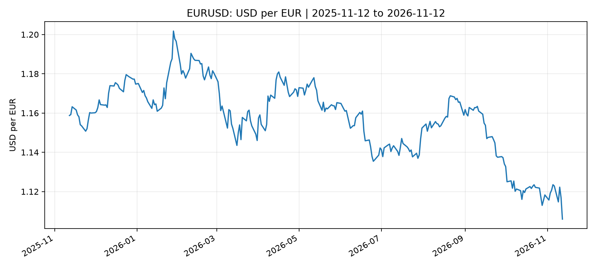
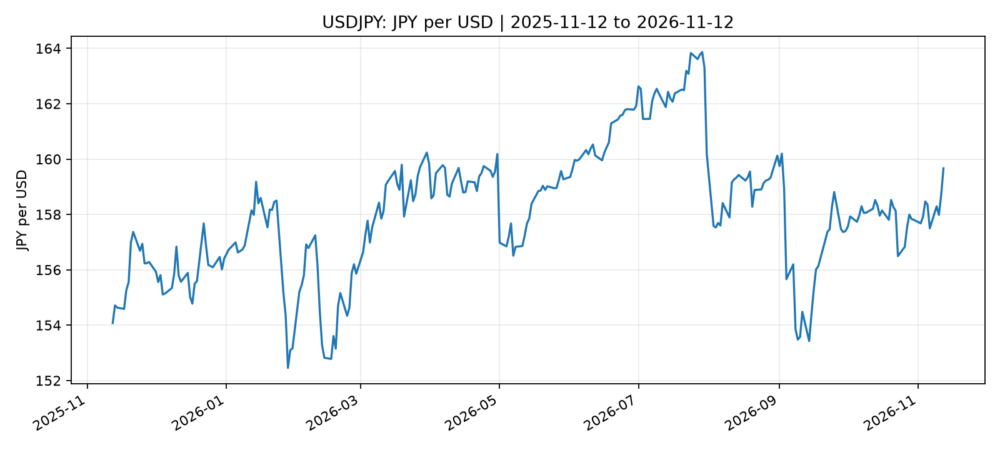
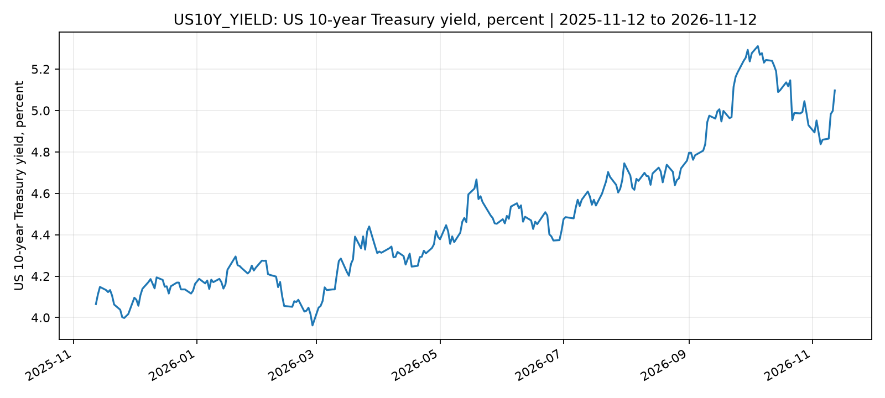

# Global FX & Macro Market Intelligence

Independent FX markets research portfolio project, using Yahoo Finance historical data (12 Nov 2025 to 12 Nov 2026).

## Deliverables
- `FX_Market_Commentary.docx`: market brief, client decision framework and scenario analysis.
- `FX_Market_Dashboard.xlsx`: summary metrics and six historical data tabs.
- `market_metrics.csv`: computed 5-, 21-, 63-session and full-sample moves.
- `outputs/`: six raw series and six trend charts plus original `market_summary.csv`.

## Headline observations
- EUR/USD: -4.56% over sample.
- GBP/USD: +0.64%.
- USD/JPY: +3.63%.
- USD/CNY: -6.43%.
- US 10-year Treasury yield: +103.2 bp (4.065% to 5.097%).
- Gold futures: -7.90%.

## Chart previews

## Methods and interpretation
Percentage returns compare first and last valid prices or the latest with 5/21/63 prior observations. Bond yields should be compared in basis points, not price returns. FX quote directions differ. Gold futures are not spot gold.

## Sources and limitations
Yahoo Finance tickers: `EURUSD=X`, `GBPUSD=X`, `JPY=X`, `CNY=X`, `GC=F`, `^TNX`. Data exported locally using yfinance and supplied for this case study. No central-bank decisions, economic news or causality claims have been independently verified. Illustrative scenarios are not forecasts or trading advice.
